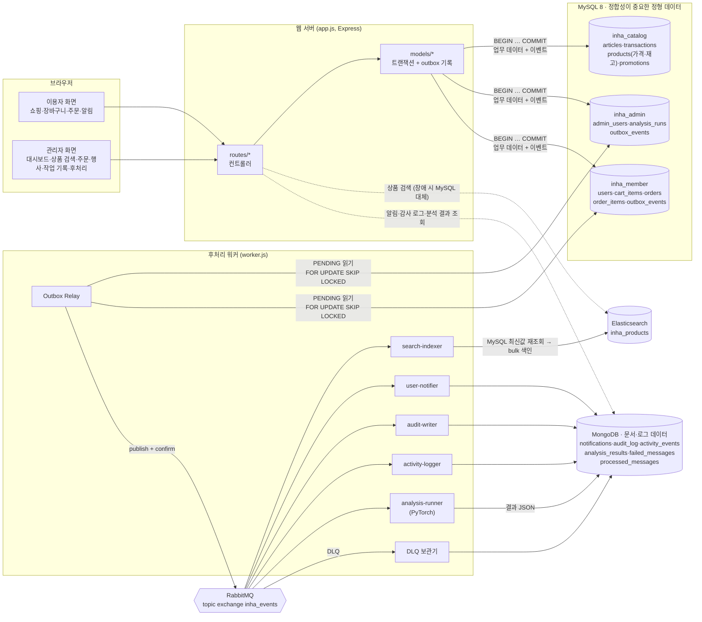
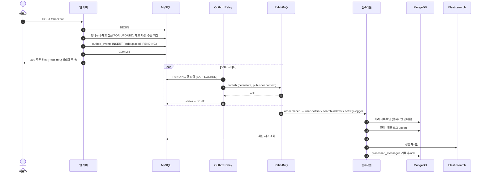
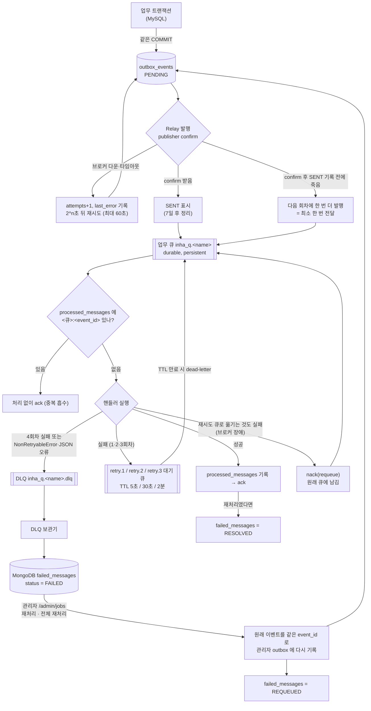

# InhaFashionPlatform 아키텍처

웹 서버가 요청에 응답하기 전에 꼭 함께 끝나야 하는 일(재고 차감, 주문 저장, 가격 변경)만 **MySQL 트랜잭션** 안에서 처리합니다.
나머지 일(알림, 감사 로그, 검색 색인, 활동 로그, PyTorch 분석)은 **RabbitMQ 후처리**로 분리합니다.
메시지를 잃지 않도록 **Transactional Outbox → 재시도 큐 → DLQ → 관리자 재처리**로 이어지는 경로를 갖췄습니다.

## 1. 전체 구성



## 2. 저장소를 나눈 기준

| 저장소 | 담는 데이터 | 고른 이유 |
|---|---|---|
| **MySQL** `inha_catalog` | H&M 원본(articles, customers, transactions), 판매 상품(가격·재고·노출), 행사 | 재고 차감과 가격 변경은 여러 행을 한 번에 바꿔야 해서 트랜잭션·잠금(`FOR UPDATE`)·CHECK 제약이 필요 |
| **MySQL** `inha_admin` | 관리자 계정, 분석 실행 상태, 관리자 outbox | 관리자와 이용자 계정 체계를 스키마 단위로 분리 |
| **MySQL** `inha_member` | 이용자 계정, 장바구니, 주문, 이용자 outbox | 주문과 재고 차감을 한 트랜잭션으로 처리 (같은 서버의 스키마 간 트랜잭션) |
| **MongoDB** | 분석 결과(큰 JSON 문서), 감사 로그, 이용자 알림, 활동 로그(90일 TTL), 처리 기록(14일 TTL), 실패 메시지 | 스키마가 자주 바뀌는 문서, 쓰기가 많고 수정이 거의 없는 로그, TTL 자동 삭제 |
| **Elasticsearch** | 상품 검색용 사본 (MySQL 상품 + 행사 + 한글 라벨) | 앞글자 검색, 오타 허용, 한글 분류 검색, 필터별 개수(패싯), 하이라이트 |

MySQL이 원본이고, Elasticsearch와 MongoDB의 파생 데이터는 언제든 다시 만들 수 있습니다.
예를 들어 `npm run search:reindex`를 실행하거나 관리자 화면의 "검색 인덱스 전체 재생성" 버튼을 누르면 됩니다.

## 3. 요청 하나가 처리되는 흐름 (이용자 주문 예)



후처리로 분리한 작업은 다음과 같습니다.

| 이벤트 (routing key) | 발생 위치 | 구독 큐 → 하는 일 |
|---|---|---|
| `order.placed` | 이용자 결제 | user-notifier(알림), search-indexer(재고 색인), activity-logger(구매 로그) |
| `order.cancelled` | 이용자 취소 | user-notifier, search-indexer |
| `order.status_changed` | 관리자 주문 상태 변경 | user-notifier, search-indexer, audit-writer |
| `product.updated` | 관리자 가격·재고 수정 | search-indexer, audit-writer |
| `promotion.approved / updated / ended` | 관리자 행사 승인·변경·종료 | search-indexer, audit-writer |
| `analysis.requested` | 관리자 "분석 실행" | analysis-runner(PyTorch 실행 → MongoDB 저장), audit-writer |
| `jobs.replayed` | 관리자 실패 작업 재처리 | audit-writer |
| `product.viewed`, `cart.item_added` | 이용자 상세 조회·장바구니 | activity-logger |

## 4. 유실·실패 대비와 재처리



각 위험에 대한 대응은 다음과 같습니다.

| 위험 | 대응 |
|---|---|
| DB에는 저장됐는데 메시지 발행 전에 서버가 죽음 | 이벤트를 **같은 트랜잭션**으로 outbox에 기록하므로 커밋됐다면 이벤트도 남아 있음 (Transactional Outbox) |
| RabbitMQ가 내려가 있음 | 웹 요청은 정상 처리되고 outbox에 쌓임. relay가 지수 백오프로 재시도하다 브로커가 돌아오면 발행. 워커는 연결이 끊기면 컨슈머를 자동으로 다시 붙임 |
| 브로커가 받기 전에 메시지 손실 | publisher confirm을 받은 뒤에만 SENT로 표시. 큐는 durable, 메시지는 persistent |
| 같은 메시지가 두 번 옴 | `processed_messages`(`<큐>:<event_id>`)로 중복을 건너뜀. 핸들러도 `event_id`를 `_id`로 쓰는 upsert, 색인은 MySQL 최신값을 다시 읽어 결과가 같음 (멱등) |
| 일시 장애 (Mongo·ES 타임아웃) | 재시도 대기 큐에서 5초, 30초, 2분 뒤 자동으로 다시 처리 |
| 계속 실패하는 메시지 | DLQ에 격리하므로 다른 메시지 처리를 막지 않음. 보관기가 MongoDB `failed_messages`로 옮겨 관리자 화면에 표시 |
| 워커가 처리 중에 죽음 | ack 전 메시지는 RabbitMQ가 다시 전달. ack는 항상 다음 위치(재시도 큐·DLQ)에 confirm으로 넣은 뒤에만 보냄 |
| 재처리 요청 자체가 유실 | 재처리도 outbox를 거쳐 발행. 같은 `event_id`라서 이미 성공한 다른 큐는 건너뛰고 **실패한 큐만** 다시 실행 |
| Elasticsearch 장애 | 관리자 상품 화면은 MySQL 검색으로 대체 동작. 밀린 색인은 재시도·재처리로 따라잡고, 전체 재색인도 가능 |
| 분석 중복 실행 | `analysis_runs` 상태(queued/running)로 막고, 이미 끝난 실행의 중복 메시지는 무시 |

## 5. 관리자 상품 검색 (Elasticsearch)

- 인덱스 문서 = `articles + products + promotions + 한글 라벨`이며, `article_id`를 `_id`로 씁니다.
- `prod_name`에는 `edge_ngram`(앞글자 검색)과 `standard + fuzziness AUTO`(오타 허용)를 함께 적용합니다.
  - 예: "chun" → Chunky, "jumpsiut" → Jumpsuit
- `labels_ko`에는 "여성 상의 블랙"처럼 한글 분류를 넣어 한글로 검색할 수 있게 합니다.
- 상품번호·제품코드는 정확히 일치할 때 가장 위에 오도록 boost를 줍니다.
- 필터: 부서, 품목, 색상, 재고 상태(품절 / 10개 미만 / 충분), 판매 여부, 행사 여부, 가격 범위(할인가 기준).
- 각 필터의 개수는 집계(aggregation)로 함께 보여 줍니다.
- 하이라이트는 `encoder: html`로 처리해 상품명에 섞인 HTML이 실행되지 않도록 합니다.

## 6. 실행 방법

```bash
docker compose up -d --wait      # MySQL · MongoDB · Elasticsearch · RabbitMQ
npm install
pip install -r analysis/requirements.txt
npm run setup                    # 샘플 데이터 → MySQL, 계정·데모 주문, PyTorch 분석 → MongoDB, ES 색인
npm start                        # 웹 서버  http://localhost:3000
npm run worker                   # 후처리 워커 (별도 터미널)
```

RabbitMQ 관리 화면은 http://localhost:15672 (inha / inha-pass) 입니다.
큐와 DLQ 상태는 관리자 화면 `/admin/jobs`에서도 볼 수 있습니다.
